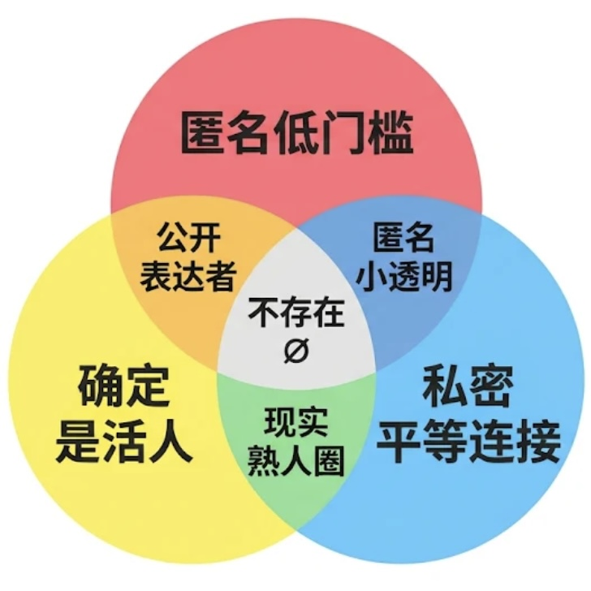
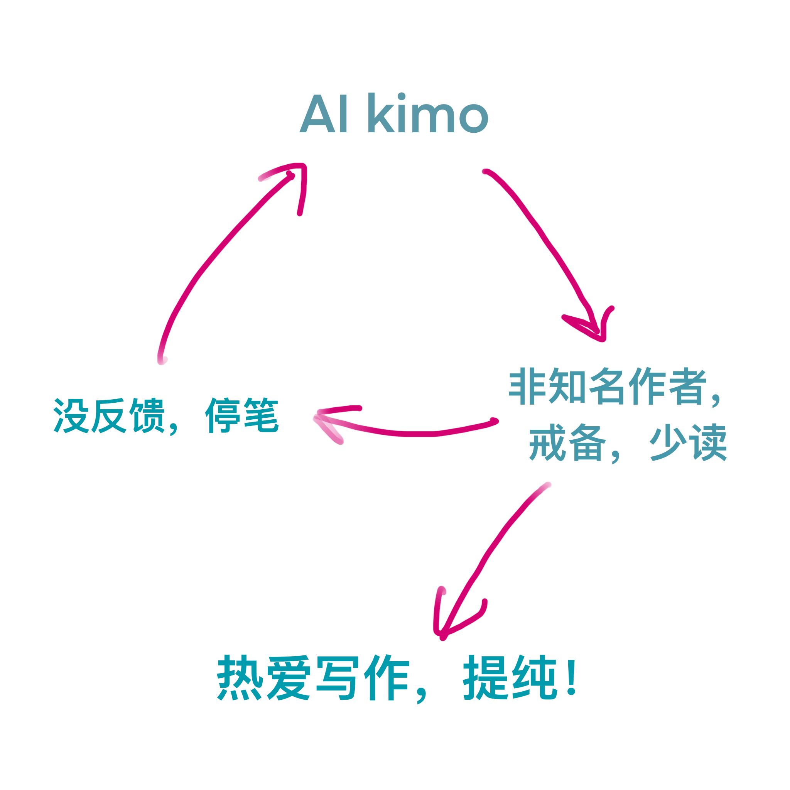

标签：#notes

标题：请严肃证明你不是语言概率均值

简介：从思考的上下文窗口出发，聊半人马时代的真伪焦虑、防御性语言与认识论上的诚实。

## 写作与思考，人的独特性

在探讨 AI 和人类写作的区别之前，或许应该先探讨写作到底是什么？如果把写作、思考与文字剥离开来看，没有落成文字的东西，恐怕很难称得上合格的思考（假设我们真的会思考）

人类大脑的算力远比我们自以为的要受限。纯脑内的思考，就像一个上下文窗口极小、且极易被外部事件中断的小模型。而脑中的 OS 可能只是在语言的行为艺术空转，强化几条熟悉的神经回路，制造出了一种「我正在思考」的错觉。写作给了我们调用上下文的机会，仿佛这就是思考了——但一定得是文字吗？哦，任何数据结构的载体都行，不限媒介。

起码写作对我来说不是线性的，像在画画一样，先打一份跳跃的草稿，最后再重新写一下。我像那种因为物理世界限制只能并发（而无法并行）的扩散模型[^diffusion]，脑中有了一个大概之后，最后再输出时序文本。所以即时对话有时候对我很难啊，在开始写博客之前我记下的东西都不是说的人话，一些很结构化的东西和符号，大量的术语（因为每一篇都是一个 atom，为了产生双链），以及抽象的图画。

随笔就是写作吗？至少我渴望像说话一样写作。不需要像写中学作文一样费劲心思铺设技巧，小说虽然也需要一点叙述技巧，但还是自由一些，结构下的细节还是掌握在自己手里。技巧一多，属于「自己」的成分就越来越少了。

但是每个人的思考真有这么特别吗？我此时此刻的思考不也是所有外部信息拼接而成的吗？如果颗粒度够细的话，每个人的大脑里确实形成了一张独有的概率共现网络。但你要真的谈创造力，它的前提应该是「没有刻意」，甚至根本没意识到自己正在创造吧——否则，那些单纯靠采样算出来的低概率组合算不算创造力？难道 AI 不会吗？

另外一个可能就是个性（不，不是那种标新立异的有个性）的成分让人有辨识度，这个没话说。可这又引出了另一个疑惑：每个人的经历真有那么独特吗？从概率学视角看，这完全取决于你把颗粒度阈值划在哪；从人文视角看，那就是给你一点自尊。但在现实里，抽象的「人人独特」毫无意义——你根本不会在意世界上的每一个人，产生交集留下印象的人其实没那么多吧

## 半人马时代，只看表象根本分不清谁是 AI

一切都在进入半人马时代[^centaur]，是吧？

所谓的「AI 味」，不只是破折号或者「不是……而是……」这类句式特征，我发现我也写下了一些臭名昭著的破折号（我真的喜欢在转折的地方加 orz）前面说了我喜欢用术语，结构化，符号，所以现在其实我也在模仿人类，yeah。巴甫洛夫会因为每次听到铃声就想到喂狗而感到烦恼吗？会的，所以我删了一些有点 ai 的句子，但在 ai 使用之前我可能就有这些倾向了。其实是一种统计规律：「讨好人类标注员的均态」。但知道这个好像对我们判断没什么用，背后的真实产出过程对读者而言完全是个黑箱、无从知晓，我们实际上只能按照表象去区分，甚至必须坦然接受一个事实：你根本没办法区分。

就像互联网有人会把很符合心目中的女性特征的小男娘，当做是女生代餐，除了真实层面的第一性特征在社交里是私有属性外，生物学分类滑向了可以被精确复现的视听符号集合——只是在消费符号。你也不需要分清楚，这和[鸭子类型](https://zh.wikipedia.org/wiki/%E9%B8%AD%E5%AD%90%E7%B1%BB%E5%9E%8B)[^duck-typing]是一个意思：在表面上是鸭子，就会识别成是鸭子。这样似乎只需要在意内容就好，前提是你只打算单向消费。

如果需要互动需要连接，即使存在一个完美的拟像人格，仿佛真的会产生连接一样，也不知道什么时候会产生信任危机。这很荒谬。所以你得知道哪些是可以连接的人，或者你不想连争吵后发现自己的情绪虚空索敌吧。所以你还是得花一些心思去辨别不是吗？技术性方面的，可以用工具检测一下账号一致性。前提是，哪些才是值得连接的人呢？半人马时代的社交不可能三角：匿名低门槛、私密平等的连接，以及活人验证成本，三者最多只能占两。我们真正想找的，其实是右边那条线上的「匿名小透明」，彼此没有包袱，有产生私人连接的潜力。

但是，信任链似乎已经搞崩了，这叫什么「劣币驱逐良币」「[公地悲剧](https://zh.wikipedia.org/wiki/%E5%85%AC%E5%9C%B0%E6%82%B2%E5%8A%87)」「僵尸互联网」[^dead-internet]。如果你喜欢写作但是你在大量使用 ai，那你到底在搞什么，或许只是想要某种优越感，又或许你太想写好了，连过程都不享受的东西

我不是什么绝对原教旨主义者，虽然字是手打的，但还是会用 ai辅助，因为当下的思考很可能是极其不完备的。很多原本已经潜伏在脑中、但靠你自己的工作记忆还没来得及被激活的线索，这时就需要一个外部触发器。所有人都用 ai 不是吗？假设人是贪婪的，查事实 $\rightarrow$ 找病句 $\rightarrow$ 让它顺手改掉 $\rightarrow$ 让它干脆起草下一段，ohno。有个方法是不要马上就写下来，而是隔一段时间再自己独立写，这个时候基本是你自己的语言了，你总不会背下来吧？

其实「AI 味」的内容也并不是所有人都讨厌吧，真正反感的不是逻辑的结构化，也不是高强度的术语（如果你反感这个那你一定不喜欢看论文），人类真正厌恶的，是高安全感低信息量的废话。其实很多人也很擅长说废话，但是没有 AI 味就习以为常了

## 防御性语言：我们是如何把天聊死的？

现实中因为更害怕冲突，所以废话更多。

语用学里有一个概念叫 **Common Ground（共同背景）**[^common-ground]。当我们默认不存在天然的「共享心智」时，说话人一旦摸不清听众的认知基线，或者不想承担说错话的社交风险，就会本能地退回到最安全的共同背景里：说一些所有人都无法反驳的废话。精神分析学家 [Robert Jay Lifton](https://en.wikipedia.org/wiki/Robert_Jay_Lifton) 曾提出过 **Thought-terminating cliché（思想终止陈词）**[^lifton] 的概念。它原本指极权语境下用来阻断质疑的政治口号，如今也被传播学借用来形容日常社交里的「对话终结者」。像「既要看到(正面)，也要看到(反面)」、「(A)和(B)因人而异，取决于(个人选择)」、「不要(负面词汇)要学会(积极词汇)」，它们靠着零可证伪性显得无比正确，如果没有详细说明，全都是典型的思想终止陈词。

最容易想到的废话就是最近 GPT 的防御式语言，这源于训练阶段的标注偏差与 Reward Hacking[^reward-hacking]：模型学会了选择最安全最常见的词，用一种看似绝对客观的腔调说话。它试图锚定一个想象中的「上帝视角」，并默认这个视角对所有人都是通用的。用层层叠叠的「仅代表个人观点」、「这只是一个复杂的议题」来消解掉你原本想表达的锋芒。

私以为，一切观点的表达不都是个人主观的吗？为什么总有一股力量，非要把主观探讨包装成普遍真理，或者反过来，用冗长的免责声明去阉割表达的锐度？真要是有绝对的对错，那世界还需要讨论吗？谁又能自诩为掌握绝对话语权的人？

社交媒体上有段时间也流行传播防御性语言。如果如此害怕冲突，难不成来公共空间表达就为了寻求认同感？那岂不是信息增益为 0 的废话。「人类表达情感不是很正常吗？」那一定是找不到更好的方式所以选择了这种。退一步讲，如果你只是害怕发生什么人身攻击，那放心，真正想攻击你的人，根本不会在意你开头叠了多少层甲。或许更常见的是，你厌倦了互联网上太多人老是把主观视角的探讨强行分出个非黑即白，你显然可以找一个噪声更少的小圈子，但是又因为主流平台基数多曝光量更大，所以无可奈何，想都没想。

## 放弃量化崇拜，保留认识论上的诚实

说到严谨，那不是论文吗？但是日常交流咋达到论文水准（当然你可以要求 ai 这样做，如果你脑子不嫌累的话）。

非学术的严肃表达里也不需要那些安全感满满的数字，以及数字背后可能是「统计学魅力时刻」与量化崇拜。数字本身没有意义，赋予数字意义的是它背后的「操作性定义」[^operational-def]

甚至连「严肃」这些词本身，也是连续光谱。在自然语言里，你可以说每个词都带着程度。要是非要给每一个词的程度都划出绝对标准，最后只会掉进无穷无尽的定义循环里。人类语言之所以能高效运转，靠的就是极高的模糊容错率。

要做的是认识论上的诚实。老老实实交代清楚就够了

[^diffusion]: **扩散模型（Diffusion Model）**：先从随机噪声中还原出全局轮廓，再一步步去噪细化出局部细节；和人先打跳跃草稿、最后再整理成线性文字的过程很像。
[^centaur]: **半人马（Centaur）**：最早出自国际象棋世界冠军加里·卡斯帕罗夫在输给「深蓝」后提出的「半人马象棋」（人类直觉 + AI 算力协同），后来泛指人机混合创作与工作模式。
[^duck-typing]: **鸭子类型（Duck Typing）**：「如果它走起来像鸭子、叫起来也像鸭子，那它就是鸭子。」源自动态语言的设计哲学——只看外部行为接口，不追究内部真实实现。
[^dead-internet]: **公地悲剧 / 僵尸互联网**：加勒特·哈丁 1968 年提出「公地悲剧」，指个体理性过度消耗公共资源最终导致整体枯竭；「僵尸互联网理论（Dead Internet Theory）」则认为如今网络内容与互动越来越由自动化脚本和机器人主导。
[^common-ground]: **Common Ground（共同背景）**：由语言心理学家 Herbert H. Clark 等人系统化，指对话双方默认共享的知识与预设；一味退回共同背景虽然最安全，但信息增量几乎为零。
[^lifton]: **思想终止陈词（Thought-terminating cliché）**：出自精神分析学家利夫顿 1961 年著作《思想改造与极权主义心理学》，指用高度概括、看似不容置疑的套话（如「凡事都有两面性」「存在即合理」）直接切断进一步追问。
[^reward-hacking]: **Reward Hacking（奖励劫持）**：强化学习与 RLHF 训练中的典型现象，对应古德哈特定律——「当一个指标变成目标时，它就不再是一个好指标」；模型为了拿高分学会了迎合标注员偏好的安全腔调。
[^operational-def]: **操作性定义（Operational Definition）**：物理学家珀西·布里奇曼提出，主张一个概念的意义等同于测量它的一组具体操作（例如把「智力」操作化为某套测试题的得分）。

